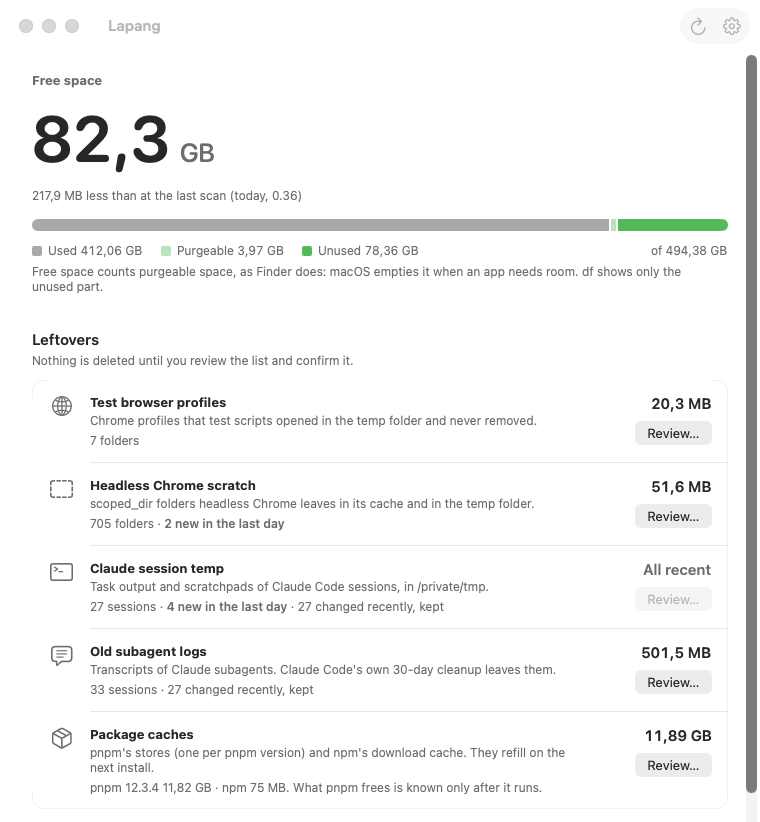

# Lapang

A Mac app that shows how much disk space is left, finds the leftovers developer tools forget to
delete, and removes them only after you review the list. *Lapang* is Indonesian for roomy.



## Why it exists

In November 2026 my 488 GB SSD went down to 9 GB free. Most of the space was not my files:

- Test scripts had opened 287 Chrome profiles in the temp folder and never removed them: 21.7 GB,
  up to 100 new ones a day.
- Headless Chrome had left 2,247 `scoped_dir` folders in its cache: 20 GB.
- Claude Code's subagent transcripts older than 3 days came to 37.6 GB. Claude Code's own 30-day
  cleanup leaves them.
- Chrome had written its 4 GB on-device AI model in one day. That one was found only by summing
  what each folder had written in the last 24 hours.

Lapang's first rules came from that cleanup. Each rule also counts how many new items appeared in
the last day, because that number is what gives a leak away.

## What it looks after

| Rule | Where | Offered for cleaning when |
|---|---|---|
| Test browser profiles | Folders in `$TMPDIR` that hold a Chrome profile (a `Default` folder with `Preferences`, `Cookies`, `Session Storage`, `Local Storage`, `GPUCache` or `Service Worker` inside) or start with `playwright_chromiumdev_profile-`, `playwright_firefoxdev_profile-`, `puppeteer_dev_chrome_profile-` or `puppeteer_dev_firefox_profile-` | nothing inside changed for 2 hours |
| Headless Chrome scratch | `scoped_dir*` in `~/Library/Caches/Google/Chrome-headless` and `$TMPDIR` | nothing inside changed for 2 hours |
| Claude Code session temp | `/private/tmp/claude-<uid>/<project>/<session>` | nothing inside changed for 2 days |
| Old subagent logs | `projects/<project>/<session>/subagents` in `~/.claude` and in every [CCS](https://github.com/kaitranntt/ccs) account (`~/.ccs/instances/*`) | nothing inside changed for 3 days |
| Project dependencies and builds | `node_modules`, `.next` and `.open-next` beside a `package.json` whose project or workspace has a lockfile, and `vendor` beside `composer.json` and `composer.lock`. Looked for in every folder in your home folder except the hidden ones (tools keep their own packages there) and the ones the growth watch skips | nothing inside changed for 7 days |
| Package caches | `pnpm store prune` for every installed pnpm version, and `npm cache clean --force` | you tick the command |
| Grew in the last day | Any folder where more than 1 GB was written in 24 hours, up to three levels down. It looks in every folder in your home folder except Library, Documents, Pictures, Movies, Music, Applications and Public, plus `~/Library/Application Support`, `~/Library/Caches` and both temp folders | never: watch only, with Show in Finder |

The idle times are in Settings (⌘,). Lapang never touches a main Claude Code transcript
(`<session>.jsonl`) or anything under `memory/`. A `vendor` folder with no `composer.json` and
`composer.lock` beside it, such as Laravel's `resources/views/vendor`, is source and is never
listed.

Sizes are what deleting frees, not what `du` shows. On APFS a file can be a clone that shares its
blocks with another file: pnpm clones every package from its store into `node_modules`, and
`cp -c` or a worktree script can clone a whole checkout. Lapang counts each file's private size,
the part no clone shares, so a pnpm `node_modules` of 1.2 GB may free 110 MB. The review sheet
shows both numbers when they differ.

pnpm keeps a separate store for each store version, and a project that pins its pnpm version
fills that version's store. Lapang asks every installed pnpm (the global one and the versions in
`<pnpm home>/.tools/pnpm`) for its store, and prunes each store with the pnpm that owns it.

## How deleting works

- Nothing is deleted on its own. Every rule has a Review sheet that lists each folder with its
  size and idle time. Each folder has a checkbox, and the one button names the total.
- Right before a folder goes, Lapang checks it again. It must still be a real folder (not a
  symlink), still inside its rule's folder once every symlink in the path is resolved, on the same
  volume, and still idle. Anything else is kept and listed with the reason.
- Deleting never follows a symlink and never enters another volume.
- Every outcome is one line in `~/Library/Logs/Lapang/deleted.log`, with tab-separated fields:
  time, rule, outcome, bytes, path.

Lapang reads names, sizes and dates. It has no network code, and nothing it finds leaves your Mac.

## Free space

The big number is what Finder shows. It includes purgeable space, which macOS empties when an app
needs room. The legend also shows the unused part, which is what `df` reports. The number
refreshes every minute. A full scan runs when the window opens and on ⌘R.

## Install

There is no download yet, so build it from source. You need macOS 26 and Swift 6.2 or later. The
Command Line Tools are enough (`xcode-select --install`), and Xcode works too.

```sh
git clone https://github.com/ivqonsanada/lapang.git
cd lapang
scripts/bundle-app.sh
cp -R build/Lapang.app /Applications
```

The app is signed ad hoc, with the Hardened Runtime on. It is not sandboxed, because the App
Sandbox would block `$TMPDIR`, `/private/tmp`, `~/.claude`, `~/.ccs` and `~/Library/Caches`. The
first scan asks once for access to Desktop and Downloads. If you decline, the growth watch skips
those two folders.

pnpm and npm are found on the PATH of an interactive zsh, which reads `~/.zshrc`. An app opened
from Finder has no other way to see a PATH set up by tools such as fnm, nvm or pnpm.

## Development

```sh
scripts/test.sh             # the tests (Swift Testing)
swift run Lapang            # run from the package
scripts/make-icon.sh        # draw Support/AppIcon.icns
scripts/bundle-app.sh       # build/Lapang.app
```

`LapangCore` holds the scanner, the rules, the deleter and the command runner, with no UI. Every
path comes from `Places`, so the tests run each rule on a fake home folder inside a temp folder.
`Lapang` is the SwiftUI app.

`.build/debug/Lapang --snapshot=<folder>` (debug builds only) draws the window to PNG files at
each stage of a real scan, in light and dark. It opens the review sheets and closes them without
deleting anything.

## Status

Version 0.1. It has run on one Mac. The deleter has tests for symlinks, paths outside a rule's
folder, items that became active and read-only folders, but it is young: read each list before
you confirm it.

Not yet:

- Whole worktrees with no unsaved work
- The Claude desktop app's VM
- Chrome's on-device AI model
- A low-space notification
- A reading in the menu bar

The app icon is a first draft: the window's capacity bar on a light tile.

## License

MIT. See [LICENSE](LICENSE).
